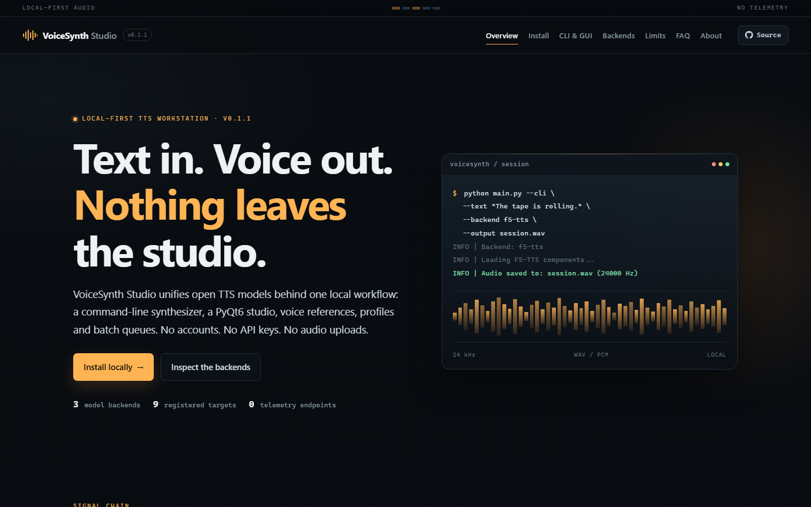
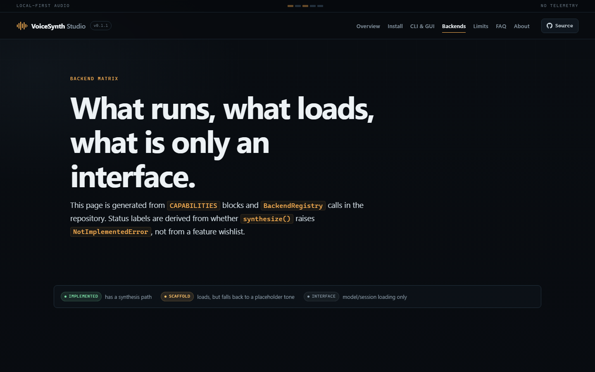

# VoiceSynth Studio — Local Text-to-Speech Synthesis

**A local-first TTS workstation with a unified backend layer, voice cloning, batch synthesis and a PyQt6 studio — no cloud API, no accounts, no telemetry.**

[](https://github.com/FiredMosquito831/LOCAL-Text-to-Speech-Synthesis/actions/workflows/ci.yml)
[](LICENSE)
[](requirements_ultimate.txt)
[](https://tts.danubelabs.net)
[](#privacy-and-security)

**Documentation:** https://tts.danubelabs.net · **Quickstart:** [tts.danubelabs.net/quickstart.html](https://tts.danubelabs.net/quickstart.html) · **Backend matrix:** [tts.danubelabs.net/backends.html](https://tts.danubelabs.net/backends.html)



## What this is

VoiceSynth Studio orchestrates open text-to-speech models on your own machine. It provides:

- A shared `TTSBackend` contract and a `BackendRegistry` with capability metadata.
- An `InferenceManager` that resolves device, precision and backend selection.
- A CLI for one-shot synthesis.
- A PyQt6 studio for text-to-speech, voice references/profiles, batch jobs and GPU monitoring.
- Local SQLite speaker profiles, sample quality scoring and `.vsp` import/export.

It is **not** a new TTS model. The model code and weights live in the upstream projects and are not vendored here.

## Backend status (read this first)

Status is derived from the source, not a roadmap. The full matrix, including every registered runtime target, is at **[tts.danubelabs.net/backends.html](https://tts.danubelabs.net/backends.html)**.

| Backend | `--backend` | Status | Notes |
|---|---|---|---|
| **F5-TTS** | `f5-tts` | **Implemented — default** | Real synthesis via upstream `f5_tts`; zero-shot reference audio, NFE steps, speed, adapters. 24 kHz. |
| **GPT-SoVITS** | `gpt-sovits` | **Implemented with stub fallback** | Calls the external GPT-SoVITS package when installed. Without it, logs a warning and returns a 220 Hz placeholder tone. 32 kHz. |
| **Fish Speech** | `fish-speech` | **Scaffold** | Import/load path only; the inference engine is not wired, so synthesis returns a 330 Hz placeholder tone. Not usable yet. |

Registered runtime targets — ONNX Runtime, OpenVINO, TensorRT-LLM, DirectML, llama.cpp (GGUF) and vLLM — can load a model or session, but their `synthesize()` methods raise `NotImplementedError`. They are **not** advertised as acceleration in this release. See [the honest matrix](https://tts.danubelabs.net/backends.html).

## Features that exist in the code

| Area | What is implemented |
|---|---|
| CLI | `--text` / `--file`, voice reference or profile, backend, quantization, device, output path, `--version`, `--help` |
| Studio | TTS editor, waveform display/playback, language/backend/adapter/NFE/sampler/speed/seed controls, chunking selector |
| Voice cloning | Reference audio drop zone, faster-whisper transcription (when installed), sample quality scoring, SQLite profiles, `.vsp` export/import |
| Batch | Priority worker queue with pause/resume/cancel, progress callbacks, per-job output paths |
| Monitoring | NVML-based GPU stats plus memory-manager statistics |
| Presets | Four VRAM presets and custom JSON presets |
| Support modules | Text chunking + crossfade stitching, spectral voice fusion, quantization catalogue, LRU memory manager |

Some support modules are library/UI-level and are not part of the CLI path. The [usage page](https://tts.danubelabs.net/usage.html) labels each one.

## Install

Requirements: **Python 3.10–3.12**, optional CUDA GPU, network access for the first weight download, and disk space for model caches.

```bash
git clone https://github.com/FiredMosquito831/LOCAL-Text-to-Speech-Synthesis.git
cd LOCAL-Text-to-Speech-Synthesis

python -m venv .venv
# Windows
.venv\Scripts\activate
# Linux / macOS
source .venv/bin/activate

python -m pip install --upgrade pip
pip install -r requirements_ultimate.txt
```

> `requirements_ultimate.txt` is a pinned **Windows/CUDA 12.1** research environment (including a Windows-only bitsandbytes wheel and `torch==2.5.1+cu121`). On Linux, install matching torch/torchaudio builds from [pytorch.org](https://pytorch.org) first, then the remaining packages.

Optional model repositories:

```bash
# GPT-SoVITS (needed for --backend gpt-sovits)
git clone https://github.com/RVC-Boss/GPT-SoVITS.git --depth 1
python scripts/setup_weights.py
```

F5-TTS weights are downloaded automatically by the backend on first synthesis. `GPT-SoVITS/` and `fish-speech/` are gitignored, so the app does not ship their weights or source.

## Quickstart

```bash
# First local synthesis (F5-TTS is the default; weights download on first use)
python main.py --cli --text "The tape is rolling." --output hello.wav

# From a text file
python main.py --cli --file input.txt --output output.wav

# Zero-shot reference voice
python main.py --cli --text "Hello" --voice reference.wav --output cloned.wav

# Force CPU / FP16
python main.py --cli --text "Hello" --device cpu --quantization fp16

# Launch the studio
python main.py
```

Full CLI reference (generated from `main.py`): https://tts.danubelabs.net/usage.html

## Project layout

```text
main.py                  Entry point: argparse CLI and PyQt6 launch
core/
  backend_base.py        TTSBackend contract + capabilities
  backend_registry.py    Registration, availability checks, auto-selector
  backend_f5.py          F5-TTS synthesis path (default)
  backend_gptsovits.py   GPT-SoVITS integration + stub fallback
  backend_fish.py        Fish Speech scaffold
  backend_*.py           ONNX / OpenVINO / TensorRT / DirectML / llama.cpp / vLLM interfaces
  inference_manager.py   Device/backend orchestration
  batch_queue.py         Priority batch worker
  profile_database.py    SQLite speaker profiles + quality scoring
  chunking.py            Text chunking + audio stitching
  voice_fusion.py        Spectral embedding fusion
  quantization.py        Quantization catalogue (some conversions are placeholders)
  presets.py             Built-in/custom VRAM presets
ui/                      PyQt6 panels, waveform, GPU monitor, styles
utils/                   NVML GPU monitoring
scripts/                 Weight setup + deterministic docs site build
site/                    Site templates/static source
docs/                    Generated GitHub Pages output
tests/                   Model-free pytest suite
training_workspace/      F5-TTS dataset prep + training launcher
```

## Tests and docs

```bash
# Model-free test suite (no downloads)
pip install -r requirements-dev.txt
python -m pytest

# Existing smoke suite (includes PyQt6 imports)
python test_all.py

# Build or verify the static site
pip install -r requirements-site.txt
python scripts/build_site.py
python scripts/build_site.py --check
```

The docs site is generated from real repository data: CLI options are parsed from `main.py`, backend status from `CAPABILITIES` blocks and `NotImplementedError` presence. Screenshots in `site/static/screenshots/` are captured from the built site with Playwright.

## Privacy and security

Text and reference audio are processed locally. The application has no analytics, telemetry, cloud TTS client or listening socket. The only network access is the Hugging Face weight download on first use (plus any manual upstream installs). Profiles are stored in `~/.config/voicesynth/profiles.db`; generated WAVs are written where you point them.

See [SECURITY.md](SECURITY.md) for the threat model and reporting process. Clone only voices you have permission to use.

## Known limitations

- **Fish Speech synthesis is not implemented.** It returns a placeholder tone.
- **Runtime accelerators are interfaces only.** ONNX, OpenVINO, TensorRT, DirectML, llama.cpp and vLLM do not synthesize audio yet.
- **No published benchmarks.** The repository ships no measured latency, RTF, WER or MOS results, and the site does not invent any. Capability metadata is labelled as such.
- **INT4 and GGUF CLI flags do not quantize F5-TTS.** On CUDA, `int8` falls back to FP16; on CPU it applies dynamic INT8.
- **CLI input is not auto-chunked.** Long-text chunking is available as a module and in the studio, not automatically on the CLI path.
- **Windows-first lockfile.** Linux users need their own torch build; the `.bat` helpers are Windows-only. DirectML is Windows-only; vLLM is Linux-only.
- **Auto-selector can recommend incomplete targets.** It scores declared capabilities, including for scaffold runtimes.
- **No provenance/watermarking.** Generated audio is plain WAV.

## Documentation & site

The site is built by `scripts/build_site.py` into `docs/` with a single `SITE_URL` constant (`scripts/site_config.py` → `https://tts.danubelabs.net`), per-page SEO metadata, JSON-LD, sitemap, robots, a custom 404 and a 1200×630 OG image. `docs/CNAME` is set to `tts.danubelabs.net`.



## License

MIT — see [LICENSE](LICENSE). Model weights and third-party libraries keep their own licenses.

## Acknowledgments

- [F5-TTS](https://github.com/SWivid/F5-TTS) — diffusion TTS and vocoder
- [GPT-SoVITS](https://github.com/RVC-Boss/GPT-SoVITS) — voice cloning
- [Fish Speech](https://github.com/fishaudio/fish-speech) — multilingual TTS
- [Ro-F5TTS](https://github.com/racai-ro/Ro-F5TTS) — Romanian adapter reference

Listing a project does not imply its backend is complete in this repository. See the [backend matrix](https://tts.danubelabs.net/backends.html).

---

Built by [FiredMosquito831](https://github.com/FiredMosquito831).
